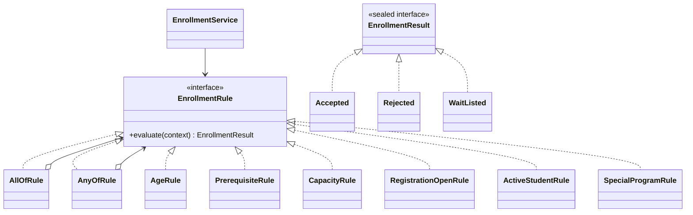

# Практика 3. Интерфейсы и полиморфизм

Готовый учебный проект CourseHub на Java 21. Решения всех 15 заданий находятся в отдельных классах `Task01`–`Task15`. Класс `Main` запускает их по порядку. В исходных файлах Java нет комментариев.

## Как открыть и запустить

Проект можно открыть в IntelliJ IDEA через `File → Open`, выбрав папку `coursehub-practice3` или файл `pom.xml`. Для заданий 12 и 15 нужна Java 21, потому что там используются `sealed interface` и `switch` с сопоставлением типов.

В Linux можно запустить проект из этой папки командой:

```bash
./run.sh
```

Скрипт компилирует все исходники командой `javac` и запускает `Main`. Если Maven установлен, также подойдут команды `mvn clean package` и `java -jar target/practice3-interfaces-polymorphism-1.0.0.jar`.

## Что сделано по заданиям

### 1. Один контракт, две реализации

`CourseFormatter` описывает метод `format(Course)`. `CompactCourseFormatter` и `DetailedCourseFormatter` реализуют один интерфейс по-разному. Компилятор проверяет, что у переменной интерфейсного типа можно вызывать только методы, объявленные в `CourseFormatter`. Какая реализация `format` сработает, определяется фактическим объектом во время выполнения.

### 2. Dynamic dispatch на бумаге

У `NotificationSender` есть `send(Object)`, а у `EmailSender` дополнительно объявлен `send(String)`. Для ссылки типа `NotificationSender` компилятор выбирает доступную сигнатуру `send(Object)`, а во время выполнения вызывается переопределённая версия фактического класса. Для переменной типа `EmailSender` вызов `send("...")` выбирает более подходящую перегрузку `send(String)` ещё на этапе компиляции. Перегрузка выбирается по типам и видимым методам compile-time типа, переопределение — по фактическому классу объекта.

### 3. Полиморфный массив

В `Task03` массив хранит три реализации `CourseFormatter`, а цикл вызывает `format` через общий интерфейс. В цикле нет `if` и проверок типов. Добавление новой реализации не требует менять сам обход массива.

### 4. Абстрактный базовый класс

`AbstractNotificationSender.send` проверяет адресата и затем вызывает абстрактный `doSend`. Метод `send` объявлен `final`, чтобы подклассы не могли случайно убрать обязательную проверку. Различающееся поведение вынесено в `doSend`, который реализуют email- и console-варианты.

### 5. Интерфейс или абстрактный класс

| Понятие | Решение | Причина и цена изменения |
|---|---|---|
| `Identifiable` | `interface` | Разные сущности могут иметь идентификатор без общего родителя. Новую реализацию легко добавить; если контракт изменится, придётся проверить все реализации. |
| `CoursePolicy` | `interface` | Это взаимозаменяемое правило. Новая политика добавляется отдельной реализацией; общий метод контракта должен оставаться достаточно простым. |
| `BaseEntity` | `abstract class` | Общие данные `id` и готовая реализация `id()` естественно разделяются между наследниками. Цена — Java-класс уже не сможет наследовать другой базовый класс. |
| `Formatter` | `interface` | Разные форматтеры должны использоваться единообразно. Новая стратегия форматирования не требует изменения клиента. |
| `ClockProvider` | Отдельный тип не создаётся | Для примера используется стандартный `java.time.Clock`. Свой класс-обёртка добавил бы мало пользы; если понадобятся несколько особых способов получения времени, отдельный интерфейс можно ввести позже. |

### 6. Переопределение без случайной перегрузки

В `CorrectHandler` используется `@Override`, поэтому компилятор проверяет сигнатуру переопределяемого метода. `AccidentalHandler.handle(Object)` не переопределяет `Handler.handle(String)`, а создаёт перегрузку. Такой код компилируется без аннотации, но вызов через ссылку типа `Handler` приводит к родительскому методу. Если при настоящем переопределении уменьшить доступ, изменить несовместимо возвращаемый тип или ошибиться в параметрах, компилятор выдаст ошибку; `@Override` помогает заметить такие ошибки раньше.

### 7. Композиция вместо наследования

`LoggingDecorator`, `MetricsDecorator` и `RetryDecorator` реализуют один `NotificationSender` и оборачивают другой объект этого же интерфейса. В первом порядке метрики и логирование охватывают весь retry как один вызов; во втором retry расположен снаружи и повторяет также логирование и увеличение счётчика. Поэтому во втором варианте количество записей лога и метрик соответствует числу попыток.

### 8. Нарушение LSP

Read-only хранилище реализует только `CourseReader` и не объявляет метод `save`. `CourseRepository` объединяет `CourseReader` и `CourseWriter`, а изменяемое хранилище реализует оба контракта. Клиент, которому нужно только чтение, зависит от `CourseReader`; он не получает операцию, которую конкретная реализация не может выполнить.

### 9. Политика допуска как стратегия

`EnrollmentService` получает `EnrollmentPolicy` через конструктор. `AgePolicy`, `PrerequisitesPolicy` и `CapacityPolicy` проверяют разные условия. Для нового правила достаточно реализовать интерфейс и передать новый объект сервису — сам сервис менять не требуется.

### 10. Конфликт default-методов

`EmailCapability` и `ConsoleCapability` объявляют один и тот же метод `channel`. Если класс реализует оба интерфейса без собственного `channel`, компилятор требует разрешить конфликт. `BothCapabilities` делает явный `override` и выбирает оба варианта через `EmailCapability.super.channel()` и `ConsoleCapability.super.channel()`.

### 11. Равенство в иерархии

В первой паре `Point` и `ColoredPoint` нарушается симметричность: обычная точка считает цветную равной по координатам, а цветная точка не считает обычную равной, потому что сравнивает ещё цвет. Первый вариант исправления — строгая проверка класса через `getClass()`, показанная в `StrictPoint` и `StrictColoredPoint`. Второй — композиция: `ComposedPoint` хранит `Position` и цвет как поля, не расширяя класс точки. Для value-объекта с окончательным (`final`) классом равенство проще поддерживать, потому что подклассы не смогут добавить новые поля и изменить правила сравнения с одной стороны.

### 12. Sealed-иерархия результата

`EnrollmentResult` разрешает только `Accepted`, `Rejected` и `WaitListed`. Метод `describe` обрабатывает все варианты через `switch` без `default`. Если добавить новый тип в список `permits`, switch, который не обрабатывает его, перестанет компилироваться, пока не будет добавлена новая ветка. Это полезная гарантия для закрытого набора состояний.

### 13. Удаление type code

В `Task13` отправка вынесена в реализации `NotificationChannel`: email, SMS и консоль. Клиент перебирает объекты интерфейса, а не сравнивает строки `notificationType` в большом `switch`. Отдельный класс имеет смысл для варианта с самостоятельным поведением; адрес email или номер телефона остаются данными объекта, а не причиной создавать отдельный класс под каждое значение.

### 14. Композиция формата и оплаты

`CourseOffering` хранит два независимых компонента: `CourseFormat` и `PaymentPolicy`. Формат отвечает за способ проведения, а политика — за стоимость. Поэтому нет девяти классов для всех сочетаний. В примере `WorkshopFormat` и `InstallmentPaymentPolicy` добавлены независимо и комбинируются без изменения уже написанных форматов и политик.

### 15. Расширяемый движок правил

Правила реализуют `EnrollmentRule` и возвращают типизированный `EnrollmentResult`: `Accepted`, `Rejected` или `WaitListed`. Реализованы шесть правил: возраст, prerequisites, вместимость, открытая регистрация, активный статус студента и специальная программа. `AllOfRule` и `AnyOfRule` позволяют комбинировать правила, а `EnrollmentService` просто вызывает `rule.evaluate(context)` и не зависит от классов конкретных правил.

Диаграмма зависимостей:



Наследование здесь применяется для реализации небольшого общего контракта интерфейса. Композиция используется, чтобы собирать правила в `allOf` и `anyOf` и комбинировать поведение без создания подкласса для каждого сочетания. `sealed` ограничивает набор результатов и позволяет компилятору проверять полноту `switch`.
